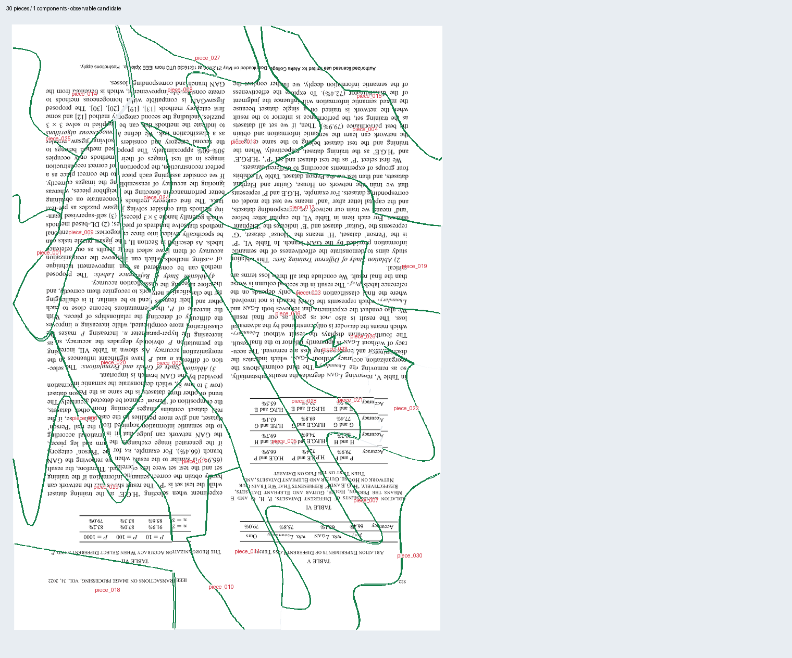

# Paper Reconstruction - Stage 4 v2.0

**Version 2.0.5** includes observed-border rotation recovery and repair of supported but misaligned capture assemblies. A cold CPU test reconstructs the six photographed pieces in 8m7s with approximately 3-9 native-pixel per-piece contour displacement measured after prediction sealing. All fourteen development controls through 30 pieces pass. See the [validation review](docs/V204_CAPTURE_ALIGNMENT_REVIEW.md) and [capture runner](docs/CAPTURE_QUALITY_RECOVERY.md); existing Stage 2/3 banks remain compatible. This release also corrects a Windows temp-path alias assertion in a runner test, preserving the qualified solver source and all previous tags.

[Capture alignment release v2.0.5](https://github.com/DanielKatzman/paper-reconstruction-stage4/releases/tag/v2.0.5) · [Stage 3 handoff](docs/STAGE3_HANDOFF.md) · [Architecture and integration](docs/ARCHITECTURE.md) · [Baseline results](docs/BASELINE.md)

**CPU is the default.** Setup installs the CPU-only Torch build and the pipeline uses `--device cpu`. CUDA is optional and must be selected explicitly. Version 2.0.0 also has CPU execution paths, but its setup/runner defaults were CUDA; v2.0.1 corrects those defaults without changing the frozen models or assembly implementation.

**1:1 means common relative physical scale.** It does not mean exact masks or pixel-perfect placement. Same-DPI scans and fixed-distance flat captures use this scale model. V21 uses separate exact/predicted mask provenance. Version 2.0.3 corrects lower-level rotation checks missed in v2.0.2, preserves continuous-angle support cycles, and adds verified partial recovery with targeted archive-angle fitting. It never fits per-piece scale or perspective.

Four inlined stages reconstruct a complete torn page: segmentation → boundary observations → ranked pair poses → global assembly. This source baseline includes the qualified Stage 3 unit-scale runtime and Stage 4 V21 revision 4, with no dependency on a sibling source checkout.

**Stage 4 owns global assembly.** The upstream stage snapshots in this repository preserve the exact pipeline used to prepare and test it. Each stage can also evolve in its own repository under a compatible release. The next orchestration repository will compose those modules into one containerized application with an API or GUI. The current release provides a working CLI pipeline; the HTTP API, GUI and container deployment are planned work.

**The development regression baseline passes 14/14 puzzles: two each at 4, 8, 12, 16, 20, 24 and 30 pieces (228 pieces).** All selected layouts are supported, connected and have zero false selected neighbor pairs. Both 30-piece Stage 4 runs finish in about two minutes. The largest measured probe displacement is 30 native pixels; correct construction is the goal.

This cohort was used during development. It assumes every piece of one rectangular page, a common native pixel scale, exact generator masks and quarter-turn captures. Page size, aspect ratio and DPI are unknown. Stage 1 inference was bypassed; Stage 2/3 evidence was prepared previously and reused for the final cold Stage 4 validation. This is not a held-out or real-camera 30-piece qualification. See [results and limitations](docs/BASELINE.md).



## Layout

| Folder | Contents |
| --- | --- |
| `stages/stage1` | Production SegFormer segmentation, generator, training/export tools |
| `stages/stage2` | Production ONNX boundary-role inference and development tools |
| `stages/stage3` | Exact qualified unit-scale-v5 source, frozen two-ranker manifest, profiling/pooling tools |
| `stages/stage4` | V21r4 global solver, independent assessment, tests and historical diagnostic tooling |
| `contracts/sdk` | Shared immutable Stage 3→4 file contract SDK |
| `compatibility.json` | Release-pinned stage versions, source inventory, model hashes and runtime assumptions |
| `baseline` | Fourteen-case manifest, measured results, previews and upstream profiles |
| `provenance` | Component source inventories, asset hashes and original baseline commitments |
| `tools` | Portable setup, asset verification, pipeline and regression commands |

The umbrella release is **2.0.5**, compatible with the v2.0.0 model/data baseline. Its source fingerprints identify the capture alignment implementation; Stage 1-3 and the original model files remain unchanged. Existing Stage 2 copyright terms are retained; this export does not grant a new open-source license.

## Clone and install

```powershell
git lfs install
git clone --branch v2.0.5 https://github.com/DanielKatzman/paper-reconstruction-stage4.git
cd paper-reconstruction-stage4
git lfs pull
python -B tools/verify_compatibility.py

powershell -File tools/setup.ps1
python -B tools/assets.py verify --groups models
python -B tools/doctor.py
```

Setup uses Python 3.14 for Stages 1/2 and Python 3.12 for Stages 3/4. Stage 3 uses CPU-only Torch 2.7.1 by default; Stages 1/2 use CPU ONNX Runtime and Stage 4 uses CPU NumPy/SciPy. Setup creates separate environments and an ignored interpreter mapping. For optional CUDA setup use `tools/setup.ps1 -Device cuda`, then pass `--device cuda` to the runner. The original recorded large-case Stage 3 timings used CUDA for rankers; they are not CPU throughput measurements.

The four frozen model files are versioned with **Git LFS** and pinned by the same release tag as the source. `compatibility.json` and the original producer manifests verify their identities. The [model ZIP](https://github.com/DanielKatzman/paper-reconstruction-stage4/releases/download/v2.0.0/models-v2.0.0.zip) is an alternative if using a source ZIP or a checkout without LFS; extract it at the repository root. A GitHub-generated source archive alone is not guaranteed to include LFS payloads.

To reproduce the fourteen-case regression, also download and extract [benchmark-v2.0.0.zip](https://github.com/DanielKatzman/paper-reconstruction-stage4/releases/download/v2.0.0/benchmark-v2.0.0.zip) at the repository root. Its observable bundles, Stage 1 generator inputs and evaluation-only references are separate asset groups. Verify the files before running:

```powershell
python -B tools/assets.py verify --groups models bundles inputs references
python -B tools/test_stage4.py
python -B -m unittest discover -s tests -v
python -B tools/pipeline.py benchmark --output outputs/v2_full_regression
```

Source-only tests do not require model/benchmark downloads: install `contracts/sdk` and `stages/stage4`, then run the two test commands. The portable Stage 4 suite passes 352 tests with 16 documented archive-dependent skips; sixteen additional tests cover orchestration, CPU defaults and mask boundaries. [Packaging validation](provenance/PACKAGING_VALIDATION.json) preserves the original relocation checks. [CPU validation](provenance/CPU_VALIDATION_2026-10-27.json) records the earlier CPU-only execution and real six-piece accuracy limitation. The [capture recovery review](docs/V203_CAPTURE_RECOVERY_REVIEW.md) describes the current fixes and their separate validation.

## Stage 4 interface

The assembly module reads an immutable Stage 3 evidence bundle. It writes a result manifest, piece placements, selected joins, preview and diagnostics. The development page profile also writes an independently verified support/geometry assessment and an observable recovery request. References are used only by the separate post-seal benchmark evaluation.

```powershell
python -B -m paper_reconstruction_stage4 solve `
  --bundle path/to/stage3_bundle `
  --config stages/stage4/configs/joint_v21_cut_repair_development.json `
  --constraint-profile stages/stage4/configs/shared_scale_complete_rectangle_v1.json `
  --capture-profile path/to/stage1/capture_profile.json `
  --output outputs/my_page/stage4
```

Run this component command with the Stage 4 interpreter created by setup (`local/envs/stage4/Scripts/python.exe`), or with a compatible environment containing the SDK and Stage 4 package. The shown profile records exact generator masks; use `shared_scale_complete_rectangle_predicted_v1.json` for predicted/reviewed masks with a matching capture declaration. Both keep scale 1.0 and use V21.

## Run on this workstation

Use this folder as the working directory. `local/runtimes.json` selects the existing validated interpreters; source imports point to this repository.

```powershell
python -B tools/doctor.py
python -B tools/assets.py verify --groups models bundles inputs references
python -B tools/test_stage4.py
python -B tools/pipeline.py benchmark --output outputs/v2_full_regression
```

The benchmark command runs cold Stage 4 inference on all 14 saved evidence bundles, seals every primary prediction, then opens references in separate evaluation processes. It writes per-stage logs and timings, previews, full solver telemetry, observed assessments, recovery requests and post-seal measurements. Choose a new output directory for each run. Progress appears immediately and every 30 seconds during longer stages.

To run fresh Stage 2, Stage 3 native inference, pooling and Stage 4 from a generator-provided Stage 1 case:

```powershell
python -B tools/pipeline.py run `
  --stage1 assets/benchmark/puzzle_000330_c783e29dd569/stage1 `
  --output outputs/v2_pipeline4 --device cpu `
  --puzzle-id puzzle_000330_c783e29dd569
```

Raw captures enter through `--captures <folder> --mode shared-scale-capture --capture-profile <json>` with a truthful shared-scale capture profile. Stage 1 runs first and supports manual mask review. This route uses V21 and predicted-mask provenance, retaining its page/support checks. Arbitrary per-piece resizing or perspective violates the declared acquisition model. See [running and assets](docs/RUNNING.md).

For captures that satisfy the declared common-scale assumptions, use the included profile:

```powershell
python -B tools/pipeline.py run `
  --captures path/to/captures --mode shared-scale-capture `
  --capture-profile profiles/shared_scale_predicted_capture_v1.json `
  --output outputs/my_real_page --device cpu
```

Fixed-distance phone photos of flat pieces are closer to the assumed acquisition, but flatness and distance alone do not prove shared pixel scale or remove perspective/lens effects. Keep the camera parallel, preserve native pixel scale and avoid independently resizing images. Real-photo segmentation/assembly must be assessed on those actual inputs; the fourteen-case exact-mask result does not qualify that route. See [CPU and capture scope](docs/CPU_AND_CAPTURE_SCOPE.md).

The first actual six-PDF CPU run completed all stages in approximately **9m11s**, but used an older Stage 4 route and misplaced a fragment. Version 2.0.2's V21 run fell back to singleton pieces. With the v2.0.3 fixes, cold Stage 4 now publishes all six in one supported candidate in approximately **10m9s**, reusing the immutable CPU-produced upstream evidence. **The small corner remains visibly misaligned**, so this is progress, not a correct full real-photo reconstruction claim. Read the [capture recovery review](docs/V203_CAPTURE_RECOVERY_REVIEW.md) for actual measurements and the remaining accuracy work. The [original CPU review](docs/REAL_CAPTURE_CPU_REVIEW_2026-10-27.md) preserves the separate full-pipeline execution test.

## New checkout

The four release model weights use Git LFS. Input datasets, full experimental outputs, environments, local paths and unrelated training checkpoints are excluded from Git. Optional model and benchmark archives preserve repository-relative paths and are authenticated by `provenance/assets.json`.

1. Clone with Git LFS to obtain the pinned models, or extract the model archive from [release v2.0.0](https://github.com/DanielKatzman/paper-reconstruction-stage4/releases/tag/v2.0.0). Extract the benchmark archive for regression testing. [Archive checksums](provenance/release_asset_checksums.json) and per-file asset receipts are included.
2. On Windows with Python 3.14 and 3.12 installed, run `powershell -File tools/setup.ps1`. It installs CPU-only Torch by default and checks both frozen rankers on CPU. CUDA is an explicit opt-in.
3. Run asset verification, `tools/doctor.py`, the tests and the benchmark above.

The pipeline does not fetch assets automatically. On the original workstation, `python -B tools/assets.py hydrate` restores optional assets from ignored `local/assets-sources.json`. Original predictions are optional audit material and are not solver inputs.

Start Stage 3 work with [the immediate handoff](docs/STAGE3_HANDOFF.md). Read [telemetry and failure attribution](docs/TELEMETRY.md) before interpreting a missing construction as missing upstream evidence.
