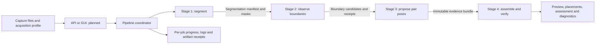

# Stage modules and the future orchestrator

This repository preserves the Stage 4 construction baseline from **v2.0.0** and adds CPU-default orchestration in **v2.0.1**. Its inlined Stage 1/2/3 snapshots make the baseline reproducible. The owner also maintains each stage separately; those repositories can publish compatible releases without requiring a separate network service for every stage.

The intended final deployment is a **modular monolith**: one application/container exposing an API or GUI, with an internal pipeline coordinator and replaceable stage modules. The current repository implements the CLI coordinator and file contracts. It does not yet contain that API, GUI or Docker deployment.

## Module responsibilities

| Module | Input | Output | Responsibility |
| --- | --- | --- | --- |
| Stage 1 | Captures/PDFs | `segmentation_manifest.jsonl`, piece images, masks, acceptance flags | Segment pieces and expose review needs |
| Stage 2 | Accepted Stage 1 observations | Boundary-role predictions, boundary candidates and immutable receipts | Describe observable edges |
| Stage 3 | Stage 1/2 files and declared acquisition profile | Native archive and pooled Stage 3→4 evidence bundle | Rank potential contacts and retain useful relative poses |
| Stage 4 | Evidence bundle, solver config and any applicable bound profiles | Result manifest, placements, selected contacts, preview, assessment/recovery request | Search global layouts and verify support, physical feasibility and page geometry |
| Orchestrator | Input job, module versions/configuration and acquisition assumptions | Job status, final artifacts and stage telemetry | Coordinate execution and expose one user-facing interface |

The contract SDK is at `contracts/sdk`; the wire-contract authority and schemas are preserved with it. `compatibility.json` pins all four stage metadata versions, their source inventory and model identities; Git LFS pins the four weight files to the release tag. Component software versions, model hashes, source fingerprints and configuration identities are separate from the umbrella release label. Marking another stage “2.0 compatible” should mean that its actual producer output passes these contracts and downstream regression checks, not merely that its version string was changed.

## Integration rules for compatible stage releases

- Keep module boundaries file-in/file-out with verified manifests and stable piece IDs, native coordinate conventions and transform direction. A future in-process adapter must preserve those same semantics.
- Bind source/model/configuration and acquisition-profile identities into each run. Do not silently resize pieces, change DPI, relax support checks or reinterpret coordinate systems across a stage boundary.
- Keep intermediate artifacts under one job directory and capture per-stage progress, timing, failure information and receipts. A normally published partial reconstruction is distinct from a supported complete page.
- Honor Stage 1 acceptance/review flags. A headless API should report a review requirement rather than pretending manual review occurred.
- Keep truth/reference data out of serving modules. Seal every benchmark prediction before the evaluation process opens references.
- Preserve this known development cohort as a regression control; use new disjoint pages to measure generalization. See `BASELINE.md` for the current acquisition limits.

## Container/application work to implement next

The future orchestration repository should add a job submission/status/artifact interface, input validation, progress streaming or polling, cancellation and explicit review/unsupported states. Its deployment must pin the stage compatibility manifest and model assets, and package the required runtimes inside one image. GPU support should be an explicit deployment option, with CPU behavior measured separately.

The validated workstation currently uses separate Python environments: 3.14 for Stages 1/2 and 3.12 for Stages 3/4. A first container can preserve that split with internal subprocesses. Consolidating interpreters is a separate compatibility/performance change to validate; it is not required by the modular monolith architecture. Stage modules do not need their own HTTP servers.

Do not treat the present synthetic exact-mask benchmark as qualification for arbitrary phone photos. The V21 complete-page profile assumes shared native scale, a full rectangular page and exact generator masks; the earlier general capture route remains separately qualified work. The coordinator must choose a truthful profile and present the resulting assessment to the caller.

The immediate algorithm priority is still Stage 3 pose coverage and latency. Its recorded 30-piece inference plus pooling takes 45–52 minutes, versus approximately two minutes for Stage 4. The [Stage 3 handoff](STAGE3_HANDOFF.md) provides concrete parent/mode misses, telemetry and acceptance comparisons.
